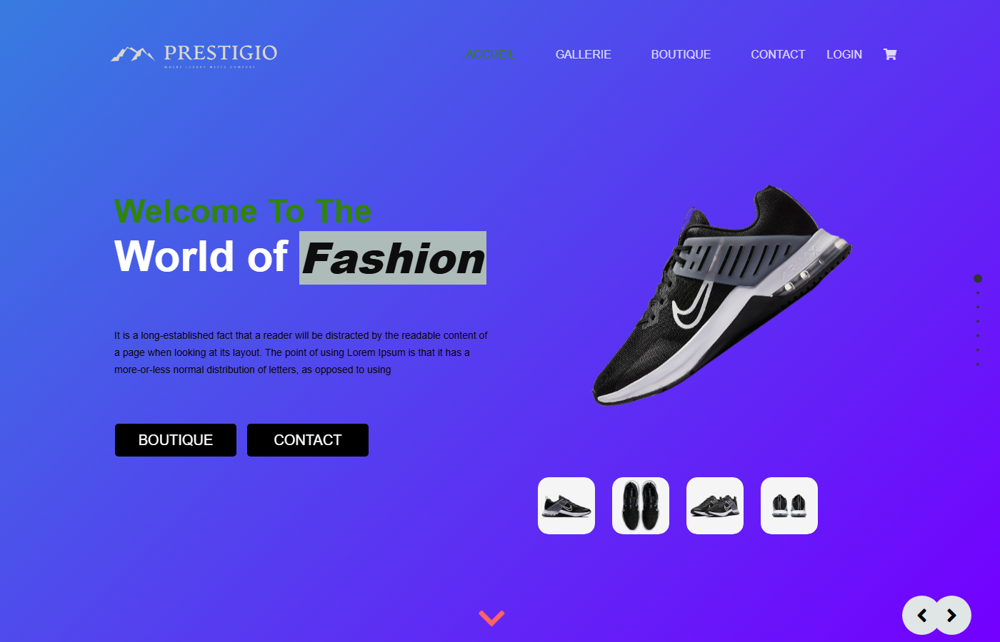
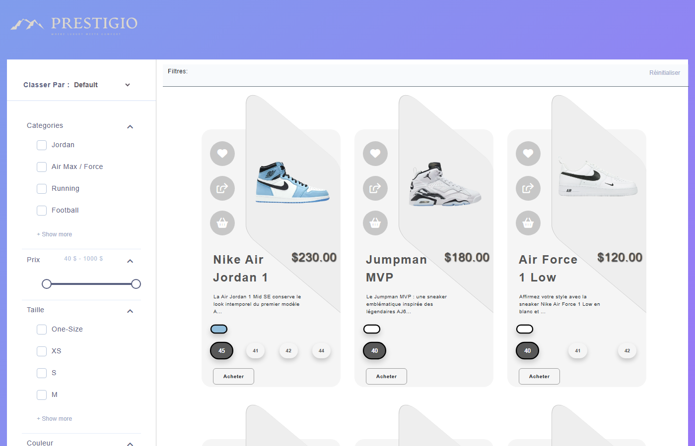
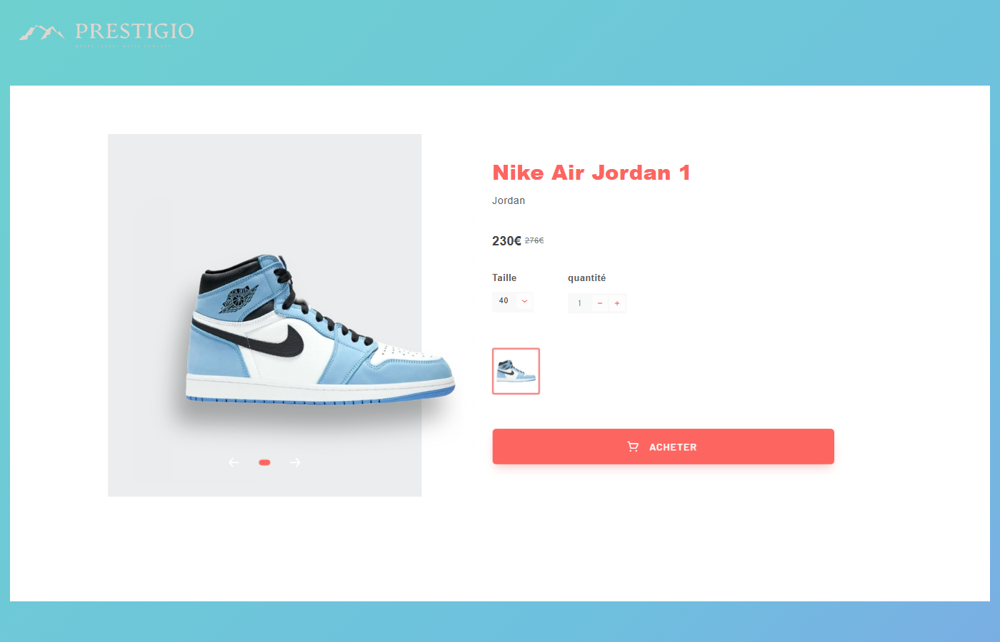
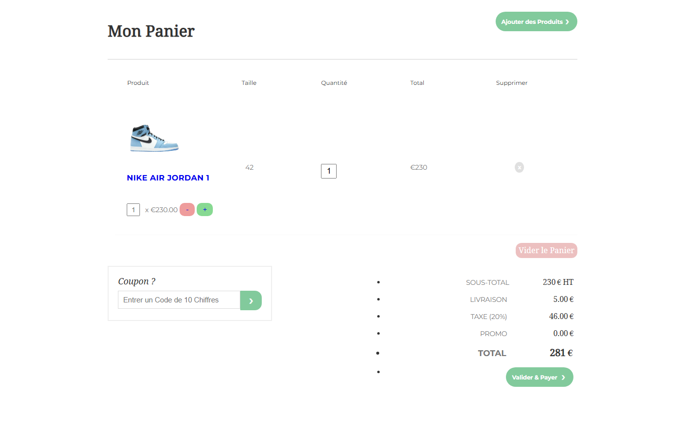
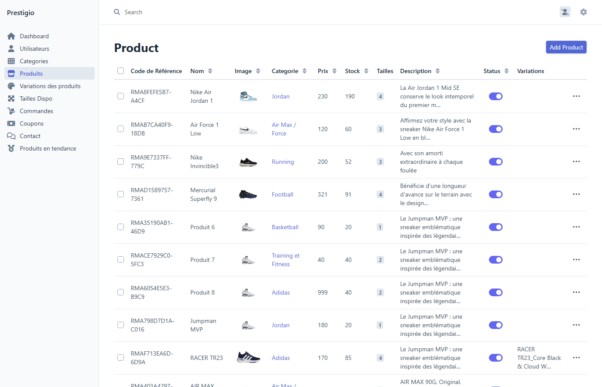

# Prestigio

Prestigio is a sneaker e-commerce site I built alone with Symfony 6.4, between late 2023 and
spring 2025, to learn how a real shop works end to end: catalogue, cart, coupons, Stripe payment,
customer accounts and a back office. It is a personal project, not a school assignment, so the
scope grew with what I wanted to try (product variations, SMS phone verification, favourites,
a user dashboard). The UI is in French.



## What it does

Front office
- Home page with featured products (`FeaturedProduct`, ordered by `displayOrder`), a gallery and a partners slider.
- Store page (`/store`) grouped by category, with client-side filters on category, price range and size.
- Product page (`/product/{reference}`) resolved by a generated reference code, showing sizes, colour variations and extra images.
- Session cart (`/cart`) with sizes and variations, quantity +/-, remove, empty.
- Coupon check by AJAX (`/check-coupon`): five coupon types (on a product, on a category, on the order, on taxes, on shipping), a validity date, a max usage counter and an `is_valid` flag.
- Orders and payment (`/commandes/ajout` then `/commandes/checkout/{id}`): the order and its lines are stored, then the total (lines + 20% VAT + 5 EUR shipping - coupon) is sent to a Stripe Checkout session. The success page marks the order as paid and shows the last 4 digits of the card.
- Accounts: registration and login (custom `LoginFormAuthenticator`, remember me), a second form for the required profile fields, then a 6-digit phone verification step.
- Favourites toggled by AJAX from the store, and a user dashboard (`/dashboard`) with orders, favourites, profile / address / password forms and an avatar.
- Contact form saved in database, flagged when the sender is an existing customer.
- Read-only JSON-LD API on products and categories (`/api`, API Platform).

Back office (EasyAdmin 4, `/admin`, role `ROLE_ADMIN`)
- CRUDs for users (with avatar upload), categories, products, product variations, sizes, orders with their lines, coupons, contact messages and featured products.
- Product form with image upload (VichUploader), a collection of sizes with quantities, additional images and variations edited inline.
- A custom validator (`ExclusiveProductOrCategory`) that checks a coupon targets a product or a category only when its type requires it.

Two console commands: `app:generate-product-references` creates a reference code for products that do
not have one (new products get theirs from a Doctrine `postPersist` subscriber), and
`app:update-coupon-validity` turns off coupons whose date has passed.

| Store | Product | Cart | Back office |
|---|---|---|---|
|  |  |  |  |

## How it is organised

```
src/
  Controller/            front controllers (store, product, cart, coupon, orders, favourites, contact, dashboard, security)
  Controller/EasyAdmin/  dashboard + one CRUD controller per entity
  Entity/                17 Doctrine entities (see below)
  Manager/               query/formatting logic kept out of controllers (StoreManager, CartManager, ProductManager, ...)
  Form/, DTO/            Symfony forms and the DTOs used by the profile forms
  Command/, EventSubscriber/, Validator/, Security/, Service/
templates/               Twig; base layout + one folder per page, EasyAdmin overrides in templates/EasyAdmin
assets/                  Webpack Encore entry (app.js, app.scss, per-page modules loaded from data-route)
public/assets/           static theme used by the pages (CSS, jQuery plugins, images)
public/uploads/          product images (sample data), user avatars are created at runtime
migrations/              Doctrine migrations
```

Entities: `User`, `UserAvatar`, `Category`, `Product`, `ProductVariation`, `ProductSize`, `AvailableSize`,
`ProductReference`, `AdditionalProductImage`, `FeaturedProduct`, `Favorite`, `Orders`, `OrdersDetails`,
`Coupons`, `CouponsTypes`, `Contact`. A product has many sizes (each linked to an `AvailableSize` with a
quantity), many variations (colour, price, own sizes and images) and one reference code; a variation also
has its own reference, so the product page works for both.

Stack: PHP 8.1, Symfony 6.4, Doctrine ORM 2, Twig, EasyAdmin 4, Stripe PHP 13, Twilio SDK, VichUploader,
Gedmo timestampable, API Platform 3, Webpack Encore with Sass and Bootstrap 5, MySQL 8.

## Running it

Requirements: PHP >= 8.1 with `pdo_mysql` and `intl`, Composer, Node 18+, MySQL 8.

```bash
composer install
npm install && npm run build          # builds public/build from assets/

cp .env.example .env.local            # set DATABASE_URL (and STRIPE_SECRET_KEY if you want to pay)
php bin/console doctrine:database:create
php bin/console doctrine:migrations:migrate

symfony serve        # or: php -S 127.0.0.1:8000 -t public
```

There are no fixtures. Register a user on `/login-register`, then give it the admin role directly in
MySQL (`UPDATE user SET roles = '["ROLE_ADMIN"]' WHERE email = '...'`) and create categories and products
from `/admin`. The product images in `public/uploads/images/products` are the ones I used during development,
so a product created with one of those file names shows an image straight away.

Notes on the external services:
- Stripe: put a test-mode key in `STRIPE_SECRET_KEY`. Without it, checkout fails; the rest of the site works.
- SMS: the Twilio call is commented out in `PhoneVerificationController::sendSms` and the code is returned in the
  JSON response, so the verification flow can be tested without an account. `SmsGenerator` contains the real call.
- reCAPTCHA: both bundles are installed and configured but the captcha field on the contact form is commented out.
- The home page intro video is not in the repository (90 MB); the popup simply shows nothing without it.

## Limitations and what I would do next

- Prices, VAT and shipping are computed in `OrdersController`; this should move to a service and be covered by tests. There are no automated tests at the moment.
- The cart is not emptied after a successful payment, and payment confirmation relies on the Stripe success URL rather than a webhook.
- The migrations were written late: the first nine only covered the early tables, so I added a catch-up migration and fixed the one that referenced a table never created. A fresh `doctrine:migrations:migrate` now builds the full schema.
- The front-end mixes a static jQuery theme (`public/assets`) with the Encore build (`assets/`). I would move everything to Encore.
- Access control was only added recently (`/admin`, `/dashboard`, `/commandes`); the other routes check the user by hand in the controllers.

## Context

Personal project, 2023-2025, developed alone (design, front, back, back office). It started as a way to
practise Symfony after a school web module and became my sandbox for payment, uploads and admin tooling.
